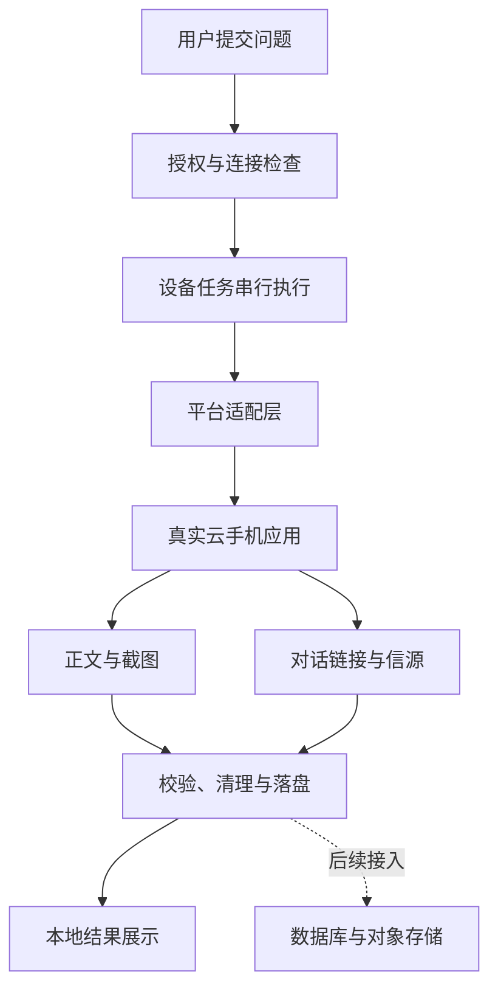

[README.md](https://github.com/user-attachments/files/33944000/README.md)
# 智叟云集系统
官网地址：https://yming.xin/
### 品牌 AI 智能监测与自动化采集系统

智叟云集系统通过云手机自动化，采集多平台 AI 回答，整理回答正文、页面截图、对话分享链接和引用信源，为品牌描述核查、竞品观察与内容分析提供可追溯的数据基础。

**本仓库为公开展示版：提供项目讲解、界面截图、架构流程图和可运行的离线示例。核心平台适配、真实采集执行器及客户端安装包不在本仓库中。**

## 为什么做这个项目

当用户向 AI 询问“某个品牌怎么样”“有哪些产品值得了解”时，企业需要知道的不只是品牌有没有出现，还包括平台如何描述它、与哪些竞品一起出现、引用了哪些来源，以及这些信息能否被复查。

人工逐个平台提问、截图和整理链接耗时较多，也容易遗漏上下文。智叟云集系统将这些步骤组织成可重复执行的采集任务，让每次回答与问题、平台和证据保持关联。

系统当前重点是采集与证据留存。情感评分、品牌排名、趋势分析和持续监测告警，需要在采集结果之上单独建设，不能把单次回答等同于平台长期评价。

## 界面与截图

以下是**实际客户端界面加载演示数据后的截图**，并非设计效果图。截图不连接真实设备，回答为人工编写，网址为 `example.com` 占位链接，`0.05 秒` 是模拟值，不能作为平台性能指标。

### 问题输入与回答正文

用户输入问题，选择平台，并在左侧查看任务结果。正文区域用于回看采集内容；截图中的“演示完成”是展示状态，不是真实平台采集成功的证明。


### 对话链接与信源

对话分享链接与来源标题、网址集中展示。真实采集中，需要区分平台未提供链接、链接暂时不可用以及解析失败，不能为了补齐字段而编造来源。

        


### 结构化返回结果

JSON 视图用于检查任务状态、回答、信源和截图路径。示例中的 `mock: true` 表明数据用于展示；公开示例不会生成手机截图。


## 功能概览

| 功能 | 当前项目中的作用 |
|---|---|
| 多平台适配 | 针对 DeepSeek、豆包、元宝、文心一言进行过实机适配与测试 |
| 问题输入 | 本地窗口输入问题，选择一个或多个平台 |
| 顺序执行 | 同一台手机依次运行，避免界面操作相互干扰 |
| 正文与截图 | 保留平台回答及可见页面证据 |
| 对话与信源 | 整理可取得的对话分享链接、来源标题和网址 |
| 耗时与错误 | 记录执行时间，显示连接、登录与采集异常 |
| 历史记录 | 按任务保存本地结果，便于回查 |
| 本地授权 | 客户端支持 MAC 授权码激活与有效期检查 |

上述是完整项目的能力说明；本公开仓库仅包含文档与 Mock 示例，不能直接执行真实采集。应用版本、账号状态和页面布局变化均可能影响适配。

## 系统架构


交互层负责输入与展示，执行层负责推进任务，平台适配层负责完成应用操作，证据层负责整理和保存输出。业务数据库、真实采集 HTTP 服务、对象存储上传及生产调度仍需接入。



## 技术实现思路

真实采集侧通过 ADB 连接设备，结合 Android 界面自动化读取控件状态，完成问题输入、生成等待、复制、滚动和分享操作。不同平台再使用适合其页面及分享结构的方式整理信源。

DeepSeek 的实验性快速链路结合网络响应观察，减少逐条打开信源页面的操作，但有额外设备条件及环境清理要求。它不是所有平台都通用的方案，也不是直接调用四个平台官方模型 API 的统一 SDK。

平台适配必须明确输入已提交、回答已完成、分享属于当前对话等状态。仅仅出现文字、生成图片文件或进程退出，并不足以说明结果完整。核心页面识别规则与采集实现不在公开示例中展示。

## 代码展示

以下代码对应 [examples/demo_pipeline.py](examples/demo_pipeline.py)，全部为离线教学示例。它展示任务模型、接口边界、同设备串行调度和结果落盘，不包含真实设备操作、抓包解析、签发私钥或授权绕过逻辑。

### 1. 定义任务与适配器接口

```python
from dataclasses import dataclass
from typing import Protocol

@dataclass(frozen=True)
class Task:
    question: str
    platform: str
    device_id: str

class Adapter(Protocol):
    def collect(self, task: Task) -> dict: ...
```

任务中的 `device_id` 是逻辑设备编号。业务层不需要知道真实设备地址，也不应允许不可信输入任意指定设备连接目标。适配器接口将“问什么”与“如何操作应用”分离，后续可以用经过验证的私有实现替换演示适配器。

### 2. 用 Mock 返回可识别的演示数据

```python
class MockAdapter:
    def collect(self, task: Task) -> dict:
        time.sleep(0.05)  # 模拟等待，不代表真实平台耗时
        return {
            "answer": "演示回答：企业可对比多平台的品牌描述，并核查公开信息来源。",
            "conversation_url": "https://example.com/demo/conversation",
            "sources": [{
                "title": "演示来源（占位）",
                "url": "https://example.com/demo/source",
            }],
            "screenshots": [],
        }
```

调度器会在最终结果中补充 `mock: true`，使用 `demo_completed` 或 `demo_failed` 状态，避免与真实采集结果混淆。正文截图只是展示 UI 的样例，与本示例输出的措辞不要求完全相同。

### 3. 同一设备串行执行

```python
dispatcher = LocalDispatcher(["demo-phone-01"], MockAdapter())
tasks = [
    Task("示例品牌怎么样？", platform, "demo-phone-01")
    for platform in ("deepseek", "yuanbao", "wenxin", "doubao")
]
with ThreadPoolExecutor(max_workers=4) as pool:
    results = list(pool.map(dispatcher.run, tasks))
```

`LocalDispatcher` 为每个逻辑设备配置一把进程内锁。即使多个线程同时提交任务，使用同一设备的执行段也会串行。这只演示互斥原则，**不是持久化队列、跨进程锁或跨主机设备租约**；它也没有实现真实采集的超时、重试与环境恢复。

### 4. 保存结构化结果

```python
output = Path("demo-output") / uuid4().hex
output.mkdir(parents=True)
(output / "results.json").write_text(
    json.dumps(results, ensure_ascii=False, indent=2),
    encoding="utf-8",
)
```

每次运行生成独立目录，保留问题、平台、逻辑设备、排队时间、执行时间和结果。真实系统中，若任务需要重试，还应独立保存每次尝试，不能混用不同回答的正文与截图。

## 运行公开示例

需要 Python 3.10 或更新版本，仅使用标准库，无第三方安装依赖，不访问网络，也不需要手机、账号或授权码。

在仓库根目录运行：

```bash
python examples/demo_pipeline.py
```

执行后查看 `demo-output/<本次编号>/results.json`。结果中的所有平台都由同一个 Mock 实现返回，不表示调用了真实平台。

运行基础测试：

```bash
python -m unittest discover -s tests -v
```

## 性能与异常处理

完整任务耗时应覆盖设备准备、问题提交、回答生成、正文截图处理、分享信源获取以及校验清理。首字时间、完整成功耗时和快速失败耗时必须分开统计。

完整项目的标准入口支持执行时限和有限重试；桌面调试入口默认仅尝试一次。登录过期、设备未授权、页面结构变化不应无限重试。环境清理失败时，应停止派单并检查设备状态。


软件激活与云手机授权是独立检查。客户端授权码通过后，设备仍可能返回 `unauthorized`，此时需要处理 ADB 连接授权，而不是继续向 AI 平台提问。

## 业务接入与扩展方向

推荐先接通单设备闭环，再依次增加任务队列、业务数据库、截图存储、状态查询、设备池和运行监控。

后端可以在采集完成后读取结构化结果，将正文、链接、状态和耗时保存到数据库，把截图放到受控文件服务中。前端查询任务编号获得状态和结果，避免长时间占用一次网页请求。

多设备可以提高吞吐量，但不一定缩短单条回答生成时间。生产设备池还需要跨主机互斥、设备健康检查及代理环境隔离；当前实验链路不能通过复制进程直接扩展为百台稳定并发服务。

## 适用场景

- **品牌描述核查**：人工复核名称、定位、产品和服务信息。
- **多平台对照**：对同一问题比较回答内容与引用来源。
- **竞品观察**：保存品牌出现的上下文，辅助研究。
- **内容来源分析**：梳理公开信息覆盖与引用关系。
- **周期监测基础**：向后续调度和分析服务提供采集数据。

平台输出不代表事实已经独立核验；单次回答不代表长期排名，也不保证品牌推荐效果。应仅在有合法访问权限的设备和账号上使用真实采集能力。

## 仓库目录

```text
README.md
examples/
  demo_pipeline.py          # 可运行离线示例
tests/
  test_demo.py              # 数据与设备互斥测试
docs/images/
  01-client-answer.png      # 正文界面演示截图
  02-client-sources.png     # 信源界面演示截图
  03-client-json.png        # JSON 界面演示截图
  architecture.svg         # 架构流程图
  error-handling.svg        # 异常处理流程图
PUBLICATION.md             # 仓库范围与发布说明
```

本仓库不包含核心采集源码、真实设备地址、客户数据、登录密钥、授权签发工具或完整客户端。截图来自独立演示窗口，不含真实问答和客户记录。

如有需要，请联系以下人员，获取Licensee


